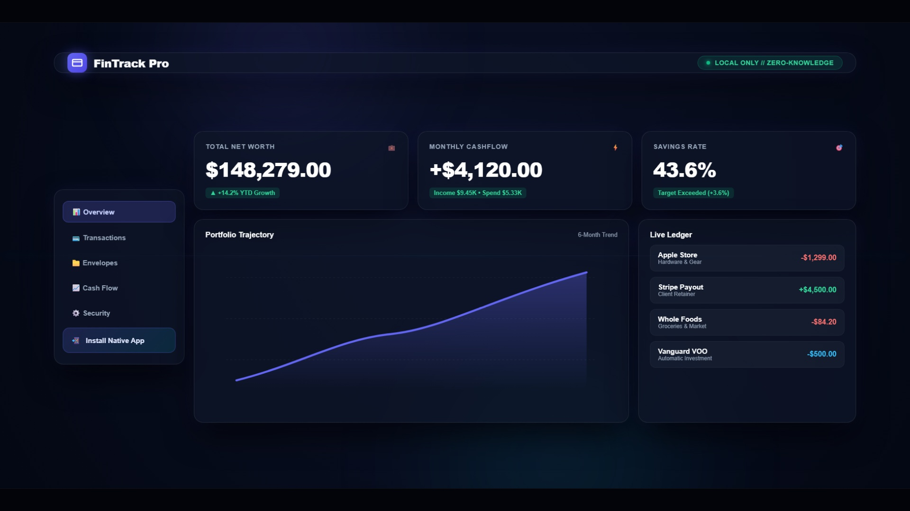
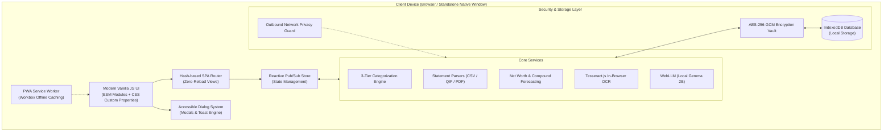

<div align="center">

# FinTrack Pro

### Total Financial Sovereignty — A Privacy-First, AI-Powered Personal Finance System

[](PROJECT.md)
[](package.json)
[](tests/e2e/a11y.spec.js)
[-3b82f6?style=for-the-badge&logo=buffer)](#)
[](docs/INSTALLATION.md)
[](#license)

<br/>

<p align="center">
  <b>FinTrack Pro</b> is a complete, installable personal finance operating system that runs <b>100% locally in your browser and on your desktop</b>. Zero accounts. Zero telemetry. Zero third-party cloud databases.
</p>

---

### 🎥 Watch the Launch Showcase (20s)

[](brag-output/brag.mp4)

> 📹 **[Click here to watch or download `brag-output/brag.mp4`](brag-output/brag.mp4)**  
> *Showcasing real-time Chart.js rendering, multi-tier statement OCR, Emil Kowalski tactile touch interactions, military-grade AES-256 client vault, and 1-click native system installation.*

</div>

---

## ⚡ Core Philosophy & Why FinTrack Pro?

Most personal finance apps ask you to surrender your most sensitive data: bank account logins, transaction histories, monthly incomes, and net worth balances stored on centralized remote servers.

**FinTrack Pro completely reverses this model:**
1. **100% Client-Side Persistence**: Every transaction, budget envelope, and account record is stored locally in your browser's IndexedDB.
2. **Zero-Knowledge Architecture**: All sensitive credentials and exports can be locked with military-grade AES-256-GCM encryption derived from PBKDF2 passphrases.
3. **Hardware-Accelerated On-Device AI**: Categorizes raw bank and UPI statements using learned patterns, 40+ regex rules, and local on-device WebLLM (Gemma 2B via WebGPU) without sending a single byte over the wire.
4. **Installable Native System**: Runs as a standalone desktop or mobile application on Windows, macOS, Linux, iOS, and Android with full offline operation.

---

## 🚀 Key Feature Highlights

### 📊 Financial Dashboard & Analytics
- **Live Net Worth & Cashflow**: Instant visual overview of your assets, liabilities, monthly savings rate, and income vs. expenses.
- **Interactive Visualizers**: Powered by Chart.js with dark-mode aesthetic styling and responsive hover tooltips.
- **KPI Metrics**: Monthly comparisons, streak tracking, and automated budget overrun alerts.

### 💳 Transaction Engine & Smart Management
- **Full CRUD with Metadata**: Accounts, categories, tags, custom notes, and split transaction balancing.
- **Automated Recurring Entries**: Configurable daily, weekly, monthly, and yearly recurring transactions with catch-up generation.
- **Instant Search & Deep Filtering**: Filter by date ranges, categories, accounts, payment types, or freeform regex queries.

### 📄 Intelligent Bank Statement Import & OCR
- **Multi-Format Ingestion**: Full support for **CSV, QIF, and PDF** statement parsing.
- **Bank Auto-Detection**: Pre-configured profiles for international (Chase, Wells Fargo, Barclays, ANZ) and Indian banking institutions (SBI, HDFC, ICICI, Axis, Kotak, PNB, BOB, Canara, Federal, IDFC).
- **UPI & Merchant Normalization**: Intelligent extraction of merchant entities from Indian UPI/NEFT/IMPS description strings.
- **Smart Deduplication Engine**: Hash-based and fuzzy-timestamp comparison preventing duplicate entries.
- **Optical Character Recognition (OCR)**: In-browser receipt scanning powered by Tesseract.js (WASM).

### 🤖 3-Tier Categorization Pipeline
```
Raw Description ──► [Tier 1: Learned User Patterns]
                         │ (Miss)
                         ▼
                    [Tier 2: 40+ Bank & Merchant Regex]
                         │ (Miss)
                         ▼
                    [Tier 3: Local WebLLM Gemma 2B / User API]
```

### 🛡️ Credential Vault & Privacy Guard
- **AES-256-GCM Encryption**: Web Crypto API standard encryption with salted PBKDF2 key derivation.
- **Zero Outbound Leakage**: Strict local network proxy intercepting and neutralizing unauthorized outbound telemetry.
- **Sanitized Exports**: Plaintext API tokens and passphrases are strictly scrubbed from JSON backups and error logs.

### 💎 Emil Kowalski Design Engineering
- **Tactile Button Feedback**: Responsive `:active { transform: scale(0.97) }` feedback tuned for natural ergonomics.
- **Spring Easings**: Custom cubic-bezier physics (`cubic-bezier(0.16, 1, 0.3, 1)`) for buttery smooth entrances.
- **Zero Native Dialog Traps**: Fully replaced browser `alert()`, `confirm()`, and `prompt()` with accessible glassmorphic modal and toast dialogs.
- **Mobile Ergonomics**: Dynamic `100dvh` viewport scaling, `-webkit-tap-highlight-color: transparent`, and 16px font-size protection to eliminate iOS Safari auto-zoom.

---

## 🏛️ System Architecture



---

## 📲 Native System Installation

FinTrack Pro is built as an installable standalone application:

| Operating System | Installation Method | Experience |
| :--- | :--- | :--- |
| **Windows 10 / 11** | Edge / Chrome "Install FinTrack Pro" in sidebar | Native window, desktop icon, start menu pin |
| **macOS** | Safari ("Add to Dock") or Chrome ("Install") | Dedicated macOS dock app, full Command-Tab integration |
| **Linux** | Chromium / Chrome PWA install | Freedesktop `.desktop` launcher & system app menu |
| **iOS / iPadOS** | Safari Share Menu → "Add to Home Screen" | Fullscreen standalone app without browser chrome |
| **Android** | Chrome / Firefox "Install App" banner | Native launcher icon with full offline support |

👉 **Read the complete guide in [docs/INSTALLATION.md](docs/INSTALLATION.md).**

---

## 🧪 Quality Assurance & Test Verification

FinTrack Pro enforces strict automated quality gates:

| Test Suite | Framework | Tests | Status |
| :--- | :--- | :---: | :---: |
| **Unit & Integration** | Vitest v5 | **197 passed** | ✅ 100% Pass |
| **End-to-End User Journeys** | Playwright | **8 passed** | ✅ 100% Pass |
| **Accessibility (Axe-Core)** | `@axe-core/playwright` | **0 violations** | ✅ WCAG 2.1 AA |
| **Static Code Analysis** | ESLint v9 | **0 errors, 0 warnings** | ✅ Clean |
| **Production Build** | Vite v8.2 | **Emitted in ~2.7s** | ✅ Zero warnings |

---

## 🛠️ Developer Quickstart

```bash
# 1. Clone the GitHub repository
git clone https://github.com/sivak/expense-tracker.git
cd expense-tracker

# 2. Install dependencies
npm install

# 3. Run unit and integration tests
npm test

# 4. Run Playwright E2E and accessibility audits
npm run test:e2e

# 5. Run static code analysis
npm run lint

# 6. Build the production release
npm run build

# 7. Preview the optimized production bundle
npm run preview
```

---

## 📁 Repository Structure

```
expense-tracker/                  # https://github.com/sivak/expense-tracker
├── index.html                    # App shell & typography tokens
├── manifest.json                 # Standalone PWA manifest
├── sw.js                         # Service Worker caching rules
├── vite.config.js                # Vite build configuration
├── PROJECT.md                    # Milestone tracker & roadmap
├── TECHNICAL_ARCHITECTURE.md     # In-depth architectural blueprint
│
├── brag-output/                  # Launch video deliverables
│   ├── brag.mp4                  # 1080p 30fps Launch Showcase Video
│   ├── brag.jpg                  # Settled poster thumbnail
│   ├── brag-plan.md              # Storyboard and creative direction
│   └── share-copy.txt            # Ready-to-publish launch copy
│
├── docs/                         # Project documentation
│   ├── INSTALLATION.md           # OS-specific installation manual
│   ├── CHANGELOG.md              # Version releases and upgrade notes
│   ├── SECURITY.md               # Zero-knowledge security model
│   └── CODEBASE_AUDIT.md         # Comprehensive audit report
│
├── public/                       # Static public assets
│   ├── manifest.json             # Root-served PWA manifest
│   ├── favicon.svg               # Application favicon
│   └── icons.svg                 # SVG sprite sheet
│
├── tests/                        # Automated test suites
│   ├── unit/                     # Unit test suites (197 tests)
│   ├── integration/              # Multi-tier database & security tests
│   ├── e2e/                      # Playwright E2E & Axe accessibility
│   └── manual/                   # Standalone manual verification scripts
│
└── src/                          # Application source code
    ├── main.js                   # Application bootstrap
    ├── router.js                 # Hash-based SPA routing
    ├── store.js                  # Reactive global state
    ├── db.js                     # IndexedDB interface
    ├── crypto.js                 # AES-256-GCM encryption
    ├── network-guard.js          # Outbound network blocker
    ├── modules/                  # Feature views (Dashboard, Budgets, etc.)
    ├── services/                 # Business logic & PWA installer
    ├── parsers/                  # Bank statement parsing engine
    ├── styles/                   # Modular CSS & Emil Kowalski easings
    └── utils/                    # Glassmorphic dialog & icon system
```

---

## 📄 License & Privacy Pledge

FinTrack Pro is open-source software licensed under the **MIT License**.

**Our Privacy Pledge**: This project will never incorporate third-party analytics trackers, remote telemetry, proprietary advertisement SDKs, or cloud synchronization mandates. Your financial sovereignty is absolute.
